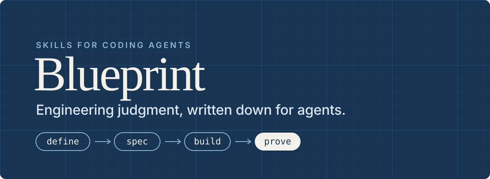
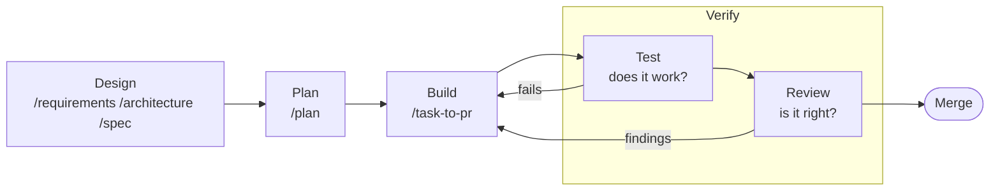

<div align="center">



# Blueprint

**Senior engineering habits for coding agents.**

Small skills for Claude Code and Codex that turn an idea into a reviewed, tested pull request.

[Quick start](#quick-start) · [Our take](#our-take) · [The workflow](#design-plan-build-verify) · [Verification](guides/verification.md) · [Example](examples/)

</div>

---

## Our take

**As models get smarter, skills get simpler.**

Agents already know how to write code. What they lack is the judgment that
experienced engineers bring to a team: write down what you are building before
you build it, prove it works, and get someone else to check it. Blueprint
encodes those habits, drawn from years of engineering experience and working
with some of the best engineers in the world.

So each skill is short. It gives the agent three things and trusts it with the rest:

| | |
|---|---|
| **A template** | The shape of a good PRD, spec, or pull request. A template beats a page of instructions. |
| **A standard of proof** | Every check passes, every acceptance criterion has a test, and the tests fail when the code is reverted. |
| **A second pair of eyes** | A fresh reviewer, ideally a different model, checks the work against the spec before a human sees it. |

The same skills work in Claude Code and Codex.

## Quick start

**1. Install**

```bash
npx skills add owainlewis/blueprint
```

**2. Describe the product.** Ask your agent:

> Use /requirements for a CRM that helps a small consulting firm track leads and follow-ups.

You get `REQUIREMENTS.md`: the PRD, written as user stories with checkable outcomes.

**3. Spec one feature.**

> Use /spec for capturing a new lead.

You get `docs/capture-lead/spec.md`: the user stories for that feature, a diagram, and the technical design an agent can build from.

**4. Ship it.**

> Use /task-to-pr for docs/capture-lead/spec.md.

The agent builds it, runs every check until green, gets an independent review,
waits for CI, fixes what comes back, and leaves a pull request ready for you.

See the full result in the [consulting CRM example](examples/).

## Design, plan, build, verify

Blueprint follows how good engineers already work. Each skill belongs to one stage.



Skip any stage the work does not need. A small, clear fix can go straight to Build.

**Verify has two parts, in order.** Test asks *does it work?*: machines run
format, lint, typecheck, tests, and browser checks. Review asks *is it right?*:
another model, then you, check that it matches the spec, is safe, and can be
maintained. Review starts only once tests pass. The
[verification guide](guides/verification.md) shows how to set up both in any
repository.

### Design

| Skill | Use it when | You get |
|---|---|---|
| [`/requirements`](skills/requirements/SKILL.md) | Starting a product or changing what it does | `REQUIREMENTS.md`, a PRD of user stories |
| [`/architecture`](skills/architecture/SKILL.md) | Designing the system or changing its shape | `ARCHITECTURE.md` with a data flow diagram |
| [`/spec`](skills/spec/SKILL.md) | A feature has decisions to settle first | User stories, a diagram, technical design, acceptance checks |
| [`/architecture-review`](skills/architecture-review/SKILL.md) | A design choice is costly to get wrong | Findings and a verdict before any code |
| [`/html-doc`](skills/html-doc/SKILL.md) | You want to share a design as a web page | A checked, static HTML view |

### Plan

| Skill | Use it when | You get |
|---|---|---|
| [`/plan`](skills/plan/SKILL.md) | A spec is too big for one pull request | Small tasks, each a working slice |

### Build

| Skill | Use it when | You get |
|---|---|---|
| [`/task-to-pr`](skills/task-to-pr/SKILL.md) | A spec or task is ready to build | A tested, reviewed pull request, left open unless you say "and merge it" |
| [`/codex-issue-coordinator`](skills/codex-issue-coordinator/SKILL.md) | You have a batch of GitHub issues for Codex | One worker and one checked PR per issue |
| [`/improve`](skills/improve/SKILL.md) | Code works but is hard to follow | Simpler code with the same behavior |

### Verify

| Skill | Use it when | You get |
|---|---|---|
| [`/test`](skills/test/SKILL.md) | You need to know it works | Every check green, and pass or fail for each criterion |
| [`/review`](skills/review/SKILL.md) | You need to know it is right | Spec fit, correctness findings, and a verdict from a fresh reviewer |

`/task-to-pr` runs Test and Review for you, then waits for CI.

## Opt-in by design

Blueprint runs only when you ask for it. "Fix this bug" gets your agent's normal
behavior; "use /task-to-pr to fix this bug" gets the full workflow. Once you
pick a workflow, it loads the skills it needs on its own.

Claude Code honors this through `disable-model-invocation: true`, and Codex
through `agents/openai.yaml`. Agents only merge when you ask them to, or when you
invoke `/codex-issue-coordinator` by name.

## Guides

- [Verification](guides/verification.md): set up testing and review for any repository.
- [Choosing a skill](guides/choosing-a-skill.md): where each skill starts and stops.
- [Workflows](guides/workflows.md): small fixes, larger features, existing systems, and issue batches.
- [Consulting CRM example](examples/): requirements, architecture, a spec, and a plan.
- [Migration](MIGRATION.md): upgrading from an older Blueprint.
- [Changelog](CHANGELOG.md)

## Project

Blueprint stays small on purpose. It is not an issue tracker, an agent runtime,
or a release system. Read [CONTRIBUTING.md](CONTRIBUTING.md) before opening a
pull request, and report security problems through [SECURITY.md](SECURITY.md).

Released under the [MIT License](LICENSE).
