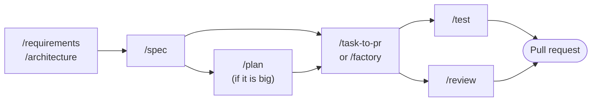

<div align="center">


**Twelve small skills that make coding agents work like senior engineers.**

[Quick start](#quick-start) · [The skills](#the-skills) · [How it fits together](#how-it-fits-together) · [Guides](#guides) · [Contribute](CONTRIBUTING.md)

</div>

## Our take

Models keep getting smarter. So the skills should get simpler, not longer.

An agent no longer needs a script for every keystroke. It already knows how to
write code, run tests, and open a pull request. What it lacks is judgment: when
to stop and write a spec, what "done" means, what proof to show, and when a
change is too big for one PR.

Blueprint writes that judgment down. Each skill is a short page that gives the
agent three things:

- **The outcome.** What finished looks like.
- **The constraints.** The few rules that matter for this step.
- **The proof.** The evidence the agent must show before it says it is done.

The rules come from years of shipping software and working with very good
engineers. They are the habits that separate a reviewed, tested pull request
from a plausible-looking diff. As models improve, we cut steps the agent no
longer needs. We keep the parts that are judgment.

## Quick start

**1. Install.** One command adds all twelve skills for Claude Code, Codex, and
other agents that read skill files.

```bash
npx skills add owainlewis/blueprint
```

**2. Try one skill.** Pick the line that matches what you are doing and paste
it into your agent.

| You want to | Ask your agent |
|---|---|
| Build a feature properly | `/spec add CSV export to the reports page` |
| Ship a small, clear change as a PR | `/task-to-pr fix the date format on invoices` |
| Check a branch before you merge | `/review this branch` |
| Prove a change works | `/test the signup flow` |
| Start a new product | `/requirements` then `/architecture` |

**3. Read what it made.** `/spec` writes `docs/<feature>/spec.md`. Read it,
change anything that is wrong, then run `/task-to-pr` on it. You get an open
pull request with tests, an independent review, and green CI.

That is the whole loop: **decide, build, prove.** You stay in charge of the
decisions. The agent does the mechanics.

## The skills

| Phase | Skill | What you get |
|---|---|---|
| **Define** | [`/requirements`](skills/requirements/SKILL.md) | `REQUIREMENTS.md`: what the product does and for whom |
| | [`/architecture`](skills/architecture/SKILL.md) | `ARCHITECTURE.md`: the system design, data model, and diagram |
| | [`/spec`](skills/spec/SKILL.md) | One feature, ready to build. The spec is the ticket. |
| **Decide** | [`/architecture-review`](skills/architecture-review/SKILL.md) | Flaws in a design, found before anyone writes code |
| | [`/plan`](skills/plan/SKILL.md) | Big work split into tasks that each ship on their own |
| **Deliver** | [`/task-to-pr`](skills/task-to-pr/SKILL.md) | A tested, reviewed pull request, left open for you |
| | [`/factory`](skills/factory/SKILL.md) | The same, then merged once every gate passes |
| | [`/codex-issue-coordinator`](skills/codex-issue-coordinator/SKILL.md) | A batch of GitHub issues worked through by Codex workers |
| **Check** | [`/test`](skills/test/SKILL.md) | Proof that each acceptance check passes, in a real browser when it is visible |
| | [`/review`](skills/review/SKILL.md) | An independent review: does it match the spec, and does it work |
| | [`/improve`](skills/improve/SKILL.md) | Simpler code with the same behavior |
| **Present** | [`/html-doc`](skills/html-doc/SKILL.md) | A clean HTML reading view of a spec or design |

## How it fits together



Use only the steps the work needs.

- **New project:** `/requirements` and `/architecture`. Keep both documents up
  to date as the project grows.
- **New feature:** `/spec`, then `/task-to-pr`. Add `/architecture-review` when a
  wrong choice would be costly, and `/plan` when the work needs several PRs.
- **Small, clear change:** go straight to `/task-to-pr`. Do not write a spec
  just to add process.

The delivery skills call `/test` and `/review` for you. You do not run each
step by hand.

## You choose when Blueprint runs

Blueprint never loads on its own. A normal request like "fix this bug" uses
your agent's usual behavior. Blueprint runs only when you name a skill.

This is on purpose. Not every change needs a spec, a review loop, and a PR.
You pick the process. The agent follows it.

- **Claude Code** respects `disable-model-invocation: true` in each skill.
- **Codex** respects `allow_implicit_invocation: false` in `agents/openai.yaml`.
- **Other agents** may not enforce this. Tell them to use Blueprint only when
  you ask.

Once you pick a skill, it can load the skills it depends on. For example,
`/factory` uses `/task-to-pr`, which uses `/test` and `/review`. Loading a
dependency never widens the scope or grants merge rights. Only naming
`/factory` or `/codex-issue-coordinator` lets the agent merge.

## Guides

- [Choosing a skill](guides/choosing-a-skill.md): where each skill starts and stops.
- [Common workflows](guides/workflows.md): small changes, big features, existing systems, and issue batches.
- [Worked example](examples/): a consulting CRM taken from requirements to a planned feature.
- [Migration guide](MIGRATION.md): remove older Blueprint skills before you upgrade.
- [Changelog](CHANGELOG.md): what changed and when.

## About

Blueprint is small on purpose. It is not an issue tracker, an agent runtime, or
a release system. It is a set of clear instructions for deciding, building,
testing, and reviewing software.

Contributions are welcome. Read [CONTRIBUTING.md](CONTRIBUTING.md) first.
Report security problems as described in [SECURITY.md](SECURITY.md).

Released under the [MIT License](LICENSE).
