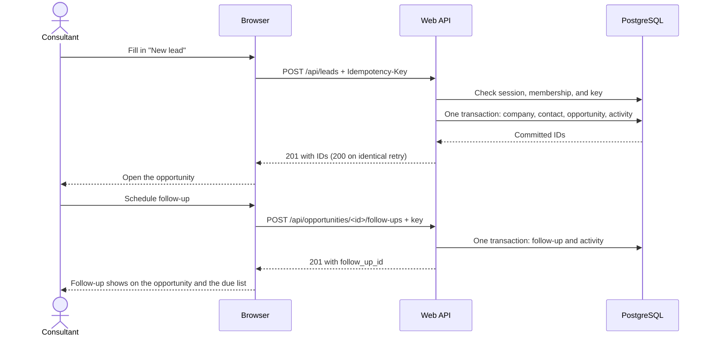

# Capture a lead and schedule its first follow-up

Status: Proposed. This is a teaching example and the spec is the ticket. It is
not implemented: the checks below are required proof, not test results.

## Problem

A consultant who meets a potential client has nowhere shared to record the lead
or its next step, so colleagues cannot see it and follow-ups get missed. This
slice lets a provisioned consultant sign in, capture a company, contact, and
opportunity, and assign the first follow-up. After reload, colleagues in the
workspace see the same pipeline and due items.

## User stories

This feature delivers [REQ-1 through REQ-4 and REQ-7](../../REQUIREMENTS.md).

1. As a consultant, I want to sign in and see only my firm's records, so that our clients stay private. (REQ-1)
2. As a consultant, I want to capture a new company, contact, and opportunity in one form, so that I can log a lead while the conversation is fresh. (REQ-2)
3. As a firm owner, I want to see every opportunity under its stage and open its details, so that I can run the sales review. (REQ-3)
4. As a consultant, I want to schedule a follow-up for myself or a colleague and see what is due today, so that no client is forgotten. (REQ-4)
5. As a consultant, I want a lost response or failed save to be safe to retry, so that I never create a duplicate lead. (REQ-7)

A denied, invalid, or failed request leaves records unchanged and keeps what the
user typed. The error table under Technical design gives each case.

## Technical design

Follow [INV-1 through INV-4](../../ARCHITECTURE.md). The architecture does not
change. This feature deliberately creates a new company and contact each time;
duplicates are allowed and merging them is later work.

Capture and scheduling each write in one transaction. A retry with the same key
returns the first result instead of writing again.

### Sign-in and views

Include OpenID Connect sign-in and the server session rules from architecture.
Only pre-provisioned active members can sign in. Deny others without creating
membership. Document provider configuration and operator provisioning. Signing
out invalidates the session; stale or missing sessions return 401 on the API and
send browser navigation to sign-in.

`/pipeline` shows the five fixed stages. Opportunity cards show title, company,
contact, and owner. Within a stage, order by created_at descending then id. An
empty stage says “No opportunities”. Clicking a card opens
`/opportunities/<id>`, showing its fields, creation activity, and open follow-ups.

`/follow-ups` lists open items due today or earlier in the workspace time zone,
ordered by due_date then id. Show summary, assignee, date, and a link to the
opportunity. List all workspace assignees, not just the current member. An empty
view says “No follow-ups due”. Listing these rows never changes them.

### Capture behavior and contract

“New lead” opens one form: company name, contact name, optional contact email,
and opportunity title. All names and the title follow the root trimming and
length rules. Reject Unicode control characters in category Cc. Email, when
provided, is trimmed, at most 254 characters, and contains one @ with nonempty
local and domain parts and no whitespace; this validates shape, not deliverability.
An empty email becomes null. Reject unknown request fields.

`POST /api/leads` accepts JSON with `company_name`, `contact_name`,
`contact_email` (string or null), and `opportunity_title`, plus a UUID
`Idempotency-Key` header. It accepts no workspace, stage, or owner fields.
The server creates the company, contact, lead-stage opportunity, and
lead_created activity in one transaction. Body is null on that activity.
The response is 201 with `opportunity_id`, `company_id`, and `contact_id`.
A completed identical retry returns 200 with the same result IDs. Compare
normalized values; JSON field order does not matter.

The browser keeps the key and entered values until it receives confirmed success.
On success it opens the opportunity. After a network error, show “We could not
confirm whether this lead was saved. Retry to check.” Retry unchanged values
with the same key. If the user edits the values after an uncertain result, require
them to retry the original submission first; do not silently create a fresh key.
Once success is confirmed, a deliberate new capture gets a fresh key.

### Schedule behavior and contract

From an opportunity, “Schedule follow-up” opens a form with summary, due date,
and assignee. Summary follows the same 1 to 120 character plain-text rules.
Date is a valid `YYYY-MM-DD` calendar date; past dates are allowed for overdue
work. Default assignee is the current member; list other active workspace members.
No due-date notification is sent.

`POST /api/opportunities/<id>/follow-ups` accepts `summary`, `due_date`, and
`assignee_member_id`, plus the same request-key header. Create the follow-up
and follow_up_scheduled activity in one transaction. The activity body is null;
the follow-up itself stores its details. Return 201 with `follow_up_id`;
identical retries return 200 with that ID. The submission operation includes
the opportunity ID, so keys cannot mix targets. Apply the same uncertain-result
and retry behavior as capture. On success refresh the opportunity's follow-ups.

### Reads, errors, and storage

`GET /api/opportunities` returns the current workspace's cards; `GET
/api/opportunities/<id>` returns its details, activities, and open follow-ups.
`GET /api/follow-ups?due=true` returns its due list. `GET /api/members` returns
only active workspace member IDs and display names for assignment.

Use the architecture's fields and foreign keys. The server validates before
writing, locks the current member and chosen assignee for write authorization,
and stores submission keys, normalized payloads, and result IDs atomically.
Unique `(workspace_id, actor_id, operation, key)` coordinates concurrent retries.
GET requests never expose submission or session rows.

| Condition | API result and browser behavior |
|---|---|
| Invalid fields or missing/malformed request key | 422 with field errors; retain values and focus the first error. No writes. |
| Missing or expired session | 401; prompt sign-in. No writes. |
| Authenticated member deactivated | 403; show access denied. No business reads or writes. |
| Opportunity absent or in another workspace | 404; show “Opportunity not found”. No writes. |
| Assignee outside the workspace, absent, or inactive | 422 with assignee error; do not reveal foreign member details. No writes. |
| Same key with different normalized payload | 409; explain the earlier submission differs. Do not overwrite it. |
| Database failure or rolled-back transaction | 503 with a generic retry message; retain values and key. No partial writes. |

Errors use `{code, message, fields}`; `fields` is a field-name map, empty for
non-validation errors. Browser errors never display SQL, tokens, or personal
data from other records. Read failures show an error state, not an empty pipeline.
All mutations enforce CSRF; rejected tokens return 403 with no writes.

## Acceptance

No CRM test runner exists here. In its application repo, use PostgreSQL integration
checks and browser scenarios with two workspaces, active and inactive members,
and a controllable identity provider. Add runnable commands when implemented.

| ID | Done when | How to check |
|---|---|---|
| AC-1 | Only a provisioned active member can sign in; sign-out invalidates access. | Exercise provider callback validation, non-member sign-in, session expiry, sign-out, and CSRF denial. Covers REQ-1. |
| AC-2 | One valid capture creates all linked records, a lead-stage opportunity owned by its creator, and one creation activity. Reload preserves the result. | Browser capture and reload; inspect PostgreSQL relationships and actor. Covers REQ-2, INV-2, INV-4. |
| AC-3 | Members see the five stages and opportunity details; empty and failed reads differ. | Two members in one workspace, fresh workspace, and injected read failure; check browser views and ordering. Covers REQ-3. |
| AC-4 | Invalid names, email, payload fields, or keys leave no lead. | Test whitespace, control characters, 120/121 character boundaries, malformed email, and unknown fields; compare rows. Covers REQ-7. |
| AC-5 | Lost responses and concurrent identical retries return one lead; changed payload returns conflict. | Drop response after commit, retry, and race two requests with one key; assert one result and activity. Covers INV-3. |
| AC-6 | Foreign opportunity and assignee IDs cannot disclose data or create relationships. | Two-workspace API requests and direct foreign-key violations; check status and unchanged rows. Covers INV-1. |
| AC-7 | A follow-up saves assignee and local due date, appears on its opportunity, and joins the due list on that date. | Check past/today/future dates around workspace midnight and a daylight-saving boundary; verify list ordering. Covers REQ-4. |
| AC-8 | Failed transactions save neither partial business rows nor submission results; follow-up retries create one activity. | Inject failures after each insert and at commit for both operations; test concurrent retries and assignment racing deactivation. Covers INV-2 through INV-4. |
| AC-9 | Forms and views work with keyboard navigation and a narrow mobile screen. | Real browser: labeled controls, focused errors, retained values, usable cards, and no page overflow. |

## Out of scope

Stage editing, manual notes, completing follow-ups, notifications, selecting an
existing company, and editing captured leads.

## Open decisions

None for the teaching design. Identity-provider registration and production
operating targets are deployment inputs. No runnable app or passing feature
checks are claimed by these documents.

Split delivery only by working result, using the [sample plan](../../../README.md#sample-plan).
The first task delivers capture from sign-in through persistence and pipeline.
The second adds follow-ups through the opportunity and due views.
