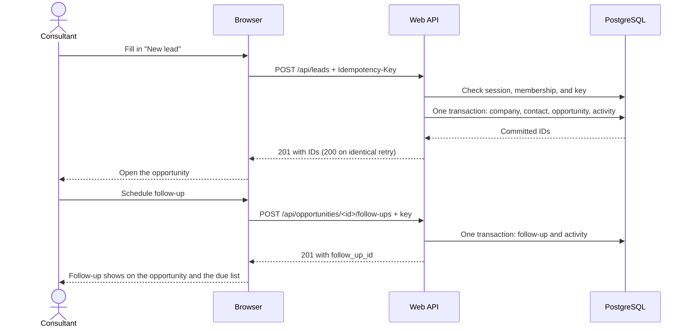

# Capture a lead and schedule its first follow-up

* Author: Blueprint maintainers
* Status: Proposed
* Date: 2026-11-10

This is a teaching example and the spec is the ticket. It is not implemented:
the checks below are required proof, not test results.

## Problem

A consultant who meets a potential client has nowhere shared to record the lead
or its next step, so colleagues cannot see it and follow-ups get missed. This
slice lets a provisioned consultant sign in, capture a company, contact, and
opportunity, and assign the first follow-up. After reload, colleagues in the
workspace see the same pipeline and due items.

## Goals

* A provisioned consultant can sign in and capture a company, contact, and opportunity in one step.
* Colleagues in the same workspace see that lead in the pipeline after a reload.
* A consultant can assign a dated follow-up, and every member sees it once it is due.
* A retried or failed save never leaves a duplicate or partial lead.
* No one can see or change another firm's records.

## Non-goals

* Editing stages or captured leads.
* Manual notes.
* Completing follow-ups.
* Notifications.
* Selecting an existing company.

## User journeys

This feature delivers [REQ-1 through REQ-4 and REQ-7](../../REQUIREMENTS.md).
The error table under Technical design gives the exact response for each
journey that goes wrong.

### J-1: Sign in to the workspace (REQ-1)

* Given: Maya is a provisioned, active member of her firm's workspace.
* When: she signs in through the identity provider.
* Then: she sees her firm's pipeline and no other firm's records. Signing out ends her access.

### J-2: Sign-in is denied (REQ-1)

* Given: a person who is not provisioned, or whose membership is deactivated.
* When: they sign in.
* Then: they see "access denied". No membership is created and no records are shown.

### J-3: Capture a lead (REQ-2)

* Given: Maya is signed in.
* When: she submits "New lead" with a company name, a contact name, an optional email, and an opportunity title.
* Then: the new opportunity opens, at the lead stage and owned by her. After a reload, her colleagues see it in the pipeline.

### J-4: Capture with invalid input (REQ-7)

* Given: Maya is signed in.
* When: she submits "New lead" with a missing or invalid field.
* Then: the form keeps what she typed and focuses the first error. Nothing is saved.

### J-5: Retry after an uncertain save (REQ-7)

* Given: Maya submitted a lead and the response was lost.
* When: she retries.
* Then: exactly one lead exists and it opens. If she changes the values first, she is asked to retry the original submission.

### J-6: Review the pipeline (REQ-3)

* Given: a workspace with opportunities at several stages.
* When: a member opens the pipeline and clicks a card.
* Then: each opportunity shows under its stage and its details open. An empty stage says "No opportunities". A failed read shows an error, not an empty pipeline.

### J-7: Schedule a follow-up (REQ-4)

* Given: Maya has an opportunity open.
* When: she schedules a follow-up with a summary, a due date, and an assignee.
* Then: it shows on the opportunity. From its due date, every member sees it in the due list.

### J-8: Reach for another firm's record (REQ-1)

* Given: Maya belongs to one workspace.
* When: she opens an opportunity, or picks an assignee, from another workspace.
* Then: she sees "Opportunity not found" or an assignee error. Nothing changes and nothing about the other firm is revealed.

### J-9: A save fails (REQ-7)

* Given: Maya is submitting a lead or a follow-up.
* When: the database fails during the save.
* Then: she sees a retry message and her values are kept. No partial records are saved.

## Technical design

Follow [INV-1 through INV-4](../../ARCHITECTURE.md). The architecture does not
change.

Capture and scheduling each write in one transaction. A retry with the same key
returns the first result instead of writing again.

### Sign-in and views

Include OpenID Connect sign-in and the server session rules from architecture.
Only pre-provisioned active members can sign in. Deny others without creating
membership. Document provider configuration and operator provisioning. Signing
out invalidates the session; stale or missing sessions return 401 on the API and
send browser navigation to sign-in.

`/pipeline` shows the five fixed stages. Opportunity cards show title, company,
contact, and owner. Within a stage, order by created_at descending then id. An
empty stage says “No opportunities”. Clicking a card opens
`/opportunities/<id>`, showing its fields, creation activity, and open follow-ups.

`/follow-ups` lists open items due today or earlier in the workspace time zone,
ordered by due_date then id. Show summary, assignee, date, and a link to the
opportunity. List all workspace assignees, not just the current member. An empty
view says “No follow-ups due”. Listing these rows never changes them.

### Capture behavior and contract

“New lead” opens one form: company name, contact name, optional contact email,
and opportunity title. All names and the title follow the root trimming and
length rules. Reject Unicode control characters in category Cc. Email, when
provided, is trimmed, at most 254 characters, and contains one @ with nonempty
local and domain parts and no whitespace; this validates shape, not deliverability.
An empty email becomes null. Reject unknown request fields.

`POST /api/leads` accepts JSON with `company_name`, `contact_name`,
`contact_email` (string or null), and `opportunity_title`, plus a UUID
`Idempotency-Key` header. It accepts no workspace, stage, or owner fields.
The server creates the company, contact, lead-stage opportunity, and
lead_created activity in one transaction. Body is null on that activity.
The response is 201 with `opportunity_id`, `company_id`, and `contact_id`.
A completed identical retry returns 200 with the same result IDs. Compare
normalized values; JSON field order does not matter.

The browser keeps the key and entered values until it receives confirmed success.
On success it opens the opportunity. After a network error, show “We could not
confirm whether this lead was saved. Retry to check.” Retry unchanged values
with the same key. If the user edits the values after an uncertain result, require
them to retry the original submission first; do not silently create a fresh key.
Once success is confirmed, a deliberate new capture gets a fresh key.

### Schedule behavior and contract

From an opportunity, “Schedule follow-up” opens a form with summary, due date,
and assignee. Summary follows the same 1 to 120 character plain-text rules.
Date is a valid `YYYY-MM-DD` calendar date; past dates are allowed for overdue
work. Default assignee is the current member; list other active workspace members.
No due-date notification is sent.

`POST /api/opportunities/<id>/follow-ups` accepts `summary`, `due_date`, and
`assignee_member_id`, plus the same request-key header. Create the follow-up
and follow_up_scheduled activity in one transaction. The activity body is null;
the follow-up itself stores its details. Return 201 with `follow_up_id`;
identical retries return 200 with that ID. The submission operation includes
the opportunity ID, so keys cannot mix targets. Apply the same uncertain-result
and retry behavior as capture. On success refresh the opportunity's follow-ups.

### Reads, errors, and storage

`GET /api/opportunities` returns the current workspace's cards; `GET
/api/opportunities/<id>` returns its details, activities, and open follow-ups.
`GET /api/follow-ups?due=true` returns its due list. `GET /api/members` returns
only active workspace member IDs and display names for assignment.

Use the architecture's fields and foreign keys. The server validates before
writing, locks the current member and chosen assignee for write authorization,
and stores submission keys, normalized payloads, and result IDs atomically.
Unique `(workspace_id, actor_id, operation, key)` coordinates concurrent retries.
GET requests never expose submission or session rows.

| Condition | API result and browser behavior |
|---|---|
| Invalid fields or missing/malformed request key | 422 with field errors; retain values and focus the first error. No writes. |
| Missing or expired session | 401; prompt sign-in. No writes. |
| Authenticated member deactivated | 403; show access denied. No business reads or writes. |
| Opportunity absent or in another workspace | 404; show “Opportunity not found”. No writes. |
| Assignee outside the workspace, absent, or inactive | 422 with assignee error; do not reveal foreign member details. No writes. |
| Same key with different normalized payload | 409; explain the earlier submission differs. Do not overwrite it. |
| Database failure or rolled-back transaction | 503 with a generic retry message; retain values and key. No partial writes. |

Errors use `{code, message, fields}`; `fields` is a field-name map, empty for
non-validation errors. Browser errors never display SQL, tokens, or personal
data from other records. Read failures show an error state, not an empty pipeline.
All mutations enforce CSRF; rejected tokens return 403 with no writes.

## Decisions

| Decision | Chosen | Instead of | Why | Cost |
|---|---|---|---|---|
| Company and contact on capture | Always create new ones | Match or pick an existing company | Requirements forbid silently merging two businesses, and a picker is its own feature. | Duplicate companies until merging ships. |
| Editing after an uncertain save | Retry the original submission first | A fresh key for the edited values | A fresh key creates a second lead when the first save did land (INV-3). | A typo cannot be fixed until the first submission is confirmed. |
| Opportunity in another workspace | 404, the same as an absent one | 403 | A 403 confirms that the record exists in another firm (INV-1). | A member cannot tell a mistyped link from a denied one. |
| Due dates in the past | Allowed | Reject dates before today | Consultants record overdue work after the fact. | A mistyped date goes straight onto the due list. |
| Who the due list covers | Every assignee in the workspace | Only the current member | The firm owner reviews all open work from one list. | A longer list with no "mine" filter yet. |

## Risks and rollout

- Security: workspace isolation and CSRF are the main risks. AC-1 and AC-6 prove them.
- Privacy: contact names and emails are personal data. Keep them out of diagnostic logs and error messages.
- Migration and compatibility: none. This is the first feature, so there is no earlier data or behavior to keep.
- Rollback: remove the feature's routes. The tables and any captured leads stay.

## Acceptance

No CRM test runner exists here. In its application repo, use PostgreSQL integration
checks and browser scenarios with two workspaces, active and inactive members,
and a controllable identity provider. Add runnable commands when implemented.

| ID | Done when | Proves | How to check |
|---|---|---|---|
| AC-1 | Only a provisioned active member can sign in; sign-out invalidates access. | J-1, J-2, REQ-1 | Exercise provider callback validation, non-member sign-in, session expiry, sign-out, and CSRF denial. |
| AC-2 | One valid capture creates all linked records, a lead-stage opportunity owned by its creator, and one creation activity. Reload preserves the result. | J-3, REQ-2, INV-2, INV-4 | Browser capture and reload; inspect PostgreSQL relationships and actor. |
| AC-3 | Members see the five stages and opportunity details; empty and failed reads differ. | J-6, REQ-3 | Two members in one workspace, fresh workspace, and injected read failure; check browser views and ordering. |
| AC-4 | Invalid names, email, payload fields, or keys leave no lead. | J-4, REQ-7 | Test whitespace, control characters, 120/121 character boundaries, malformed email, and unknown fields; compare rows. |
| AC-5 | Lost responses and concurrent identical retries return one lead; changed payload returns conflict. | J-5, INV-3 | Drop response after commit, retry, and race two requests with one key; assert one result and activity. |
| AC-6 | Foreign opportunity and assignee IDs cannot disclose data or create relationships. | J-8, INV-1 | Two-workspace API requests and direct foreign-key violations; check status and unchanged rows. |
| AC-7 | A follow-up saves assignee and local due date, appears on its opportunity, and joins the due list on that date. | J-7, REQ-4 | Check past/today/future dates around workspace midnight and a daylight-saving boundary; verify list ordering. |
| AC-8 | Failed transactions save neither partial business rows nor submission results; follow-up retries create one activity. | J-9, INV-2 through INV-4 | Inject failures after each insert and at commit for both operations; test concurrent retries and assignment racing deactivation. |
| AC-9 | Forms and views work with keyboard navigation and a narrow mobile screen. | J-3, J-6, J-7 | Real browser: labeled controls, focused errors, retained values, usable cards, and no page overflow. |

## Open decisions

None for the teaching design. Identity-provider registration and production
operating targets are deployment inputs. No runnable app or passing feature
checks are claimed by these documents.

Split delivery only by working result, using the [sample plan](../../../README.md#sample-plan).
The first task delivers capture from sign-in through persistence and pipeline.
The second adds follow-ups through the opportunity and due views.
