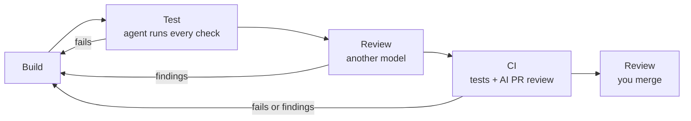

# Set up verification

An agent's work is done when it is verified, not when the agent says so.
Verification has two parts, in order:

| | Question | Who | What runs |
|---|---|---|---|
| **Test** | Does it work? | Machines | Format, lint, typecheck, tests, browser checks |
| **Review** | Is it right? | Someone reads it | Another model, then you: does it match the spec, is it safe, can we maintain it |

Review starts only once tests pass. There is no point reading code that does
not work.



Blueprint's [`/task-to-pr`](../skills/task-to-pr/SKILL.md) runs this whole loop.
The setup below makes it work in any repository, with or without Blueprint.

## Test: does it work?

### 1. The agent tests its own work

Add this to `AGENTS.md`, which Codex reads. Add a line with `@AGENTS.md` to
`CLAUDE.md` so Claude Code reads it too. Fill in your commands.

```markdown
## Done means tested

Before you say a task is done, run every check:

- Format: <command>
- Lint: <command>
- Typecheck: <command>
- Tests: <command>

If a check fails, fix the cause and run all of them again. After three rounds
on the same failure, stop and report it with the output.

Never skip, delete, or weaken a test or lint rule to get green. Never say a
check passed unless you ran it. List each command you ran and its result.
```

[`/test`](../skills/test/SKILL.md) applies the same rule, proves each acceptance
criterion, and runs browser flows in Playwright for anything visible.

### 2. CI runs the same checks

CI catches what only fails on a clean machine. Run the same checks on every
pull request and make them required in branch protection:

```yaml
# .github/workflows/ci.yml
name: CI
on: pull_request
jobs:
  test:
    runs-on: ubuntu-latest
    steps:
      - uses: actions/checkout@v4
      - run: <install command>
      - run: <format check>
      - run: <lint>
      - run: <typecheck>
      - run: <tests>
```

## Review: is it right?

### 3. Another model reviews it

The agent that wrote the code is the worst one to review it. Once tests pass,
run a reviewer with a clean context, ideally a different model:

- **Blueprint:** [`/review`](../skills/review/SKILL.md) checks the change
  against the spec, runs bad inputs through it, and reverts the code to confirm
  the new tests would catch a regression. Run it with `codex exec` if Claude
  wrote the code, or `claude -p` if Codex did.
- **Claude Code built-ins:** `/code-review` for bugs and `/security-review` for
  security holes on the current branch.

Fix what they find, then test again.

### 4. AI review on the pull request

Turn on Codex code review for the repository in Codex settings, or comment
`@codex review` on a PR. Codex follows a "Review guidelines" section in
`AGENTS.md`, so local and PR review judge by the same rules:

```markdown
## Review guidelines

- Flag only problems this PR introduces that break behavior, lose data, open a
  security hole, or break a public contract.
- Check that each new test would fail if the change were reverted.
- Check input handling at every trust boundary: network, auth, SQL, shell, file paths.
- Flag secrets or tokens in code, logs, or error messages.
- Skip style and formatting. The linter owns those.
- Give the file and line, the exact trigger, and the fix.
```

### 5. You review and merge

By now the PR passes every check and has two independent reviews. Your job is
the part agents are worst at: is this the right change, and is the risk
acceptable?

Use a PR template so every PR answers that up front. Blueprint's
[template](../.github/pull_request_template.md) asks for What, Why, What
changed, Verification (commands, results, screenshots), and Risk (database,
API contract, auth, and data-deletion changes are High).

Merge it yourself, or tell `/task-to-pr` to merge once every check passes.
