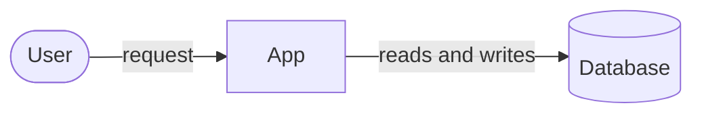

# Architecture

Fill in this template in root `ARCHITECTURE.md`. It describes the system you intend to build and stays current as it changes. Product needs go in [requirements](../requirements/SKILL.md); one feature's design goes in a [spec](../spec/SKILL.md).

## Steps

1. Read `REQUIREMENTS.md`, the repository instructions, and any existing code, schemas, and infrastructure. Check every claim about the current system against them.
2. Ask the user about each decision that shapes the system: boundaries, who owns which data, dependencies, and hard limits. Give your recommended answer with each question.
3. Choose the simplest design that meets the requirements. For each big decision, name the strongest alternative and why you did not pick it.
4. Fill in the template. Render the diagram and check that it matches the text.
5. Stop when the document is ready for review. Do not plan tasks or write code.

## Template

````markdown
# <System> architecture

Status: Proposed | Accepted. <What is built today, and what is not yet.>

## Intended system

<Two or three sentences: the main parts and the source of truth.>



<One line on the main flow and any trust boundary the reader must know.>

## Responsibilities

<What each part owns, what it must not own, and which way dependencies point.>

## Data model

<Core entities, how they relate, who owns each, and the rules that keep data consistent.>

## Critical flows

<The flows that matter most, step by step, including failure and retry.
Give each rule every feature must follow an INV-n ID and say how it is checked.>

## Security and operations

<Trust boundaries, who can do what, deployment, monitoring, and recovery.>

## Decisions

| Decision | Chosen | Instead of | Why | Cost |
|---|---|---|---|---|

## Open decisions

<Each unanswered question, your recommended answer, and what it blocks.>
````

## Rules

- Keep existing `INV-n` IDs. Never reuse or renumber them.
- Mark a decision Accepted only when a human approves it. Accepted is not the same as built.
- Never invent workload or latency numbers. Mark unknown targets as open decisions.
- Update this document when a change moves ownership, data, interfaces, trust boundaries, or deployment.

## Return

Report the path, the main decisions and their tradeoffs, and any blocking question.
