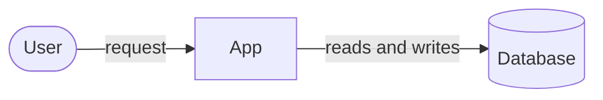

# [System] architecture

* Author: [Author name or GitHub handle]
* Status: [Draft | Proposed | In Review | Approved]
* Date: [YYYY-MM-DD]

<!-- One line on what is built today, and what is not yet. -->

## Intended system

<!-- Two or three sentences: the main parts and the source of truth. -->

<!-- One line on the main flow and any trust boundary the reader must know. -->

## Responsibilities

<!-- What each part owns, what it must not own, and which way dependencies point. -->

## Data model

<!-- Core entities, how they relate, who owns each, and the rules that keep data consistent. -->

## Critical flows

<!-- The flows that matter most, step by step, including failure and retry.
Give each rule every feature must follow an INV-n ID and say how it is checked. -->

## Security and operations

<!-- Trust boundaries, who can do what, deployment, monitoring, and recovery. -->

## Decisions

| Decision | Chosen | Instead of | Why | Cost |
|---|---|---|---|---|
| [Decision] | [Choice] | [Strongest alternative] | [Reason] | [What it costs] |

## Open decisions

<!-- Each unanswered question, your recommended answer, and what it blocks. -->

* [Question]: [recommended answer]. [What it blocks.]
