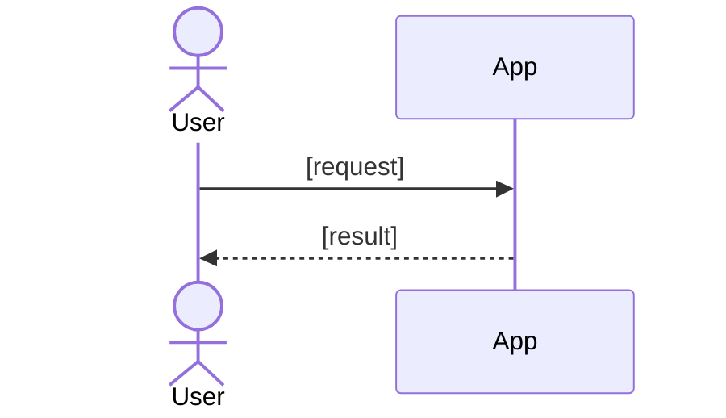

# [Feature name]

* Author: [Author name or GitHub handle]
* Status: [Draft | Proposed | In Review | Approved | Delivered (PR link)]
* Date: [YYYY-MM-DD]

## Problem

<!-- Who is affected, what goes wrong for them today, and why it matters.
Two to four sentences. -->

## Goals

<!-- What this feature achieves. Each goal is an outcome someone can check. -->

* Goal 1
* Goal 2

## Non-goals

<!-- What this change does not do. This sets the limit for the agent that builds it. -->

* Non-goal 1
* Non-goal 2

## User journeys

<!-- One journey for each thing a user does with this feature, and one for each
way it goes wrong: denied, invalid input, and failure. Cite the REQ-n each delivers. -->

### J-1: [Short name] (REQ-n)

* Given: [who the user is and the state they start from]
* When: [what the user does]
* Then: [what the user sees and what is saved]

## Technical design

<!-- A Mermaid diagram of the main flow: the parts this change touches, what moves
between them, and the order. It is for the human reviewer, so keep it to one
screen and label every arrow. -->

<!-- What the agent needs to build it: the modules and interfaces it changes, data
and schema changes, API contracts, migrations, and where the tests go.
Name any change to ARCHITECTURE.md. -->

## Decisions

<!-- One row for each choice a reviewer could question. -->

| Decision | Chosen | Instead of | Why | Cost |
|---|---|---|---|---|
| [Decision] | [Choice] | [Strongest alternative] | [Reason] | [What it costs] |

## Risks and rollout

<!-- Only what is a real risk for this change: security and privacy, data migration,
compatibility, and how to release it and roll it back. -->

## Acceptance

| ID | Done when | Proves | How to check |
|---|---|---|---|
| AC-1 | [Observable result] | [J-n, REQ-n, or INV-n] | [Test, command, or browser flow] |

## Open decisions

<!-- Each unanswered question, your recommended answer, and whether it blocks delivery. -->

* [Question]: [recommended answer]. [Blocks delivery, or does not.]
